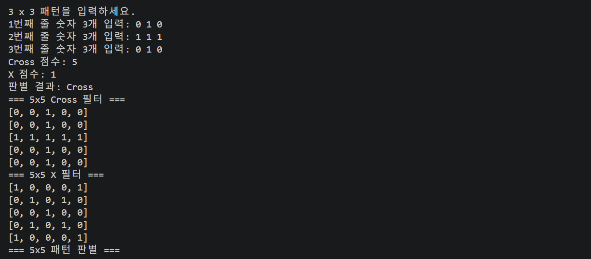
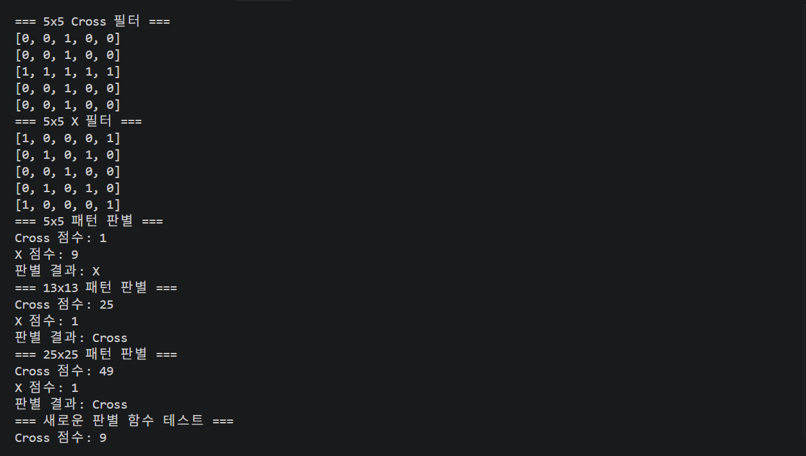
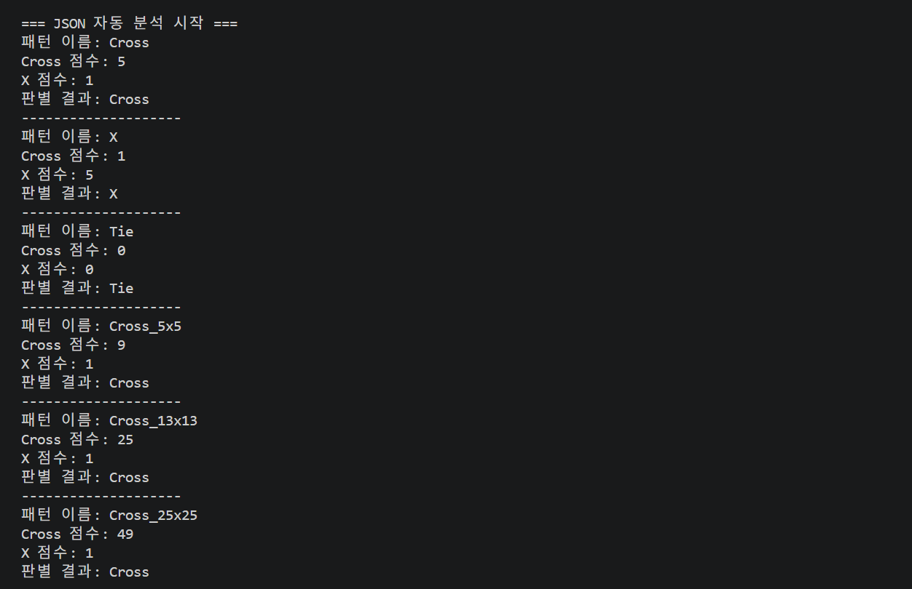
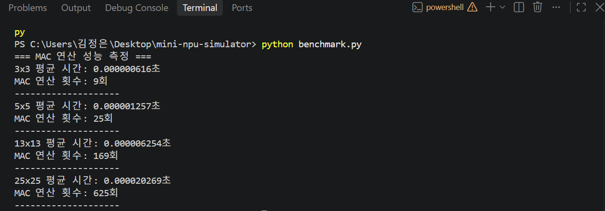

# Mini NPU Simulator

Python으로 구현한 간단한 NPU 시뮬레이터입니다.

## 프로젝트 소개

MAC(Multiply-Accumulate) 연산을 이용하여
Cross(+) 패턴과 X 패턴을 판별하는 프로그램입니다.

## 주요 기능

- 3x3 패턴 사용자 입력
- MAC 연산을 통한 패턴 판별
- JSON 파일 데이터 읽기
- Cross / X / Tie 판별
- 5x5, 13x13, 25x25 패턴 분석

## 실행 방법

python main.py

## 실행 결과 및 증거 자료

### 1. 3×3 사용자 입력 및 패턴 판별

사용자가 0과 1로 구성된 3×3 패턴을 입력하면
MAC 연산을 통해 Cross 또는 X 패턴을 판별합니다.



### 2. 필터 생성 및 다양한 크기의 패턴 판별

5×5 Cross / X 필터를 생성하고,
13×13 및 25×25 패턴까지 판별합니다.



### 3. JSON 데이터 자동 분석

JSON 파일에 저장된 6개 패턴을 자동으로 읽어
Cross, X, Tie 결과를 판별합니다.



## MAC 연산 성능 측정

Python의 `time.perf_counter()`를 사용하여
각 패턴 크기별 MAC 연산을 1,000회 반복 측정하고,
1회당 평균 실행 시간을 계산했습니다.

| 패턴 크기 | MAC 연산 횟수 | 평균 실행 시간 |
|---|---:|---:|
| 3×3 | 9회 | 0.000000616초 |
| 5×5 | 25회 | 0.000001257초 |
| 13×13 | 169회 | 0.000006254초 |
| 25×25 | 625회 | 0.000020269초 |

### 성능 측정 결과



### 시간 복잡도 분석

MAC 연산은 이중 반복문을 사용하여
N×N 크기의 패턴을 순회합니다.

따라서 하나의 필터에 대한 MAC 연산 횟수는 N²이며,
시간 복잡도는 O(N²)입니다.

패턴 크기가 커질수록 MAC 연산 횟수와
실행 시간이 증가하는 경향을 확인했습니다.

※ 실행 시간은 측정 환경에 따라 달라질 수 있습니다.


## 추가 프로그램 실행 방법

### 패턴 데이터 자동 생성

```bash
python generate_data.py
```

13×13, 25×25 Cross 패턴을 생성하고
기존 JSON 데이터에 추가합니다.

### MAC 연산 성능 측정

```bash
python benchmark.py
```

3×3, 5×5, 13×13, 25×25 패턴의
MAC 연산을 각각 1,000회 반복하여
평균 실행 시간을 측정합니다.